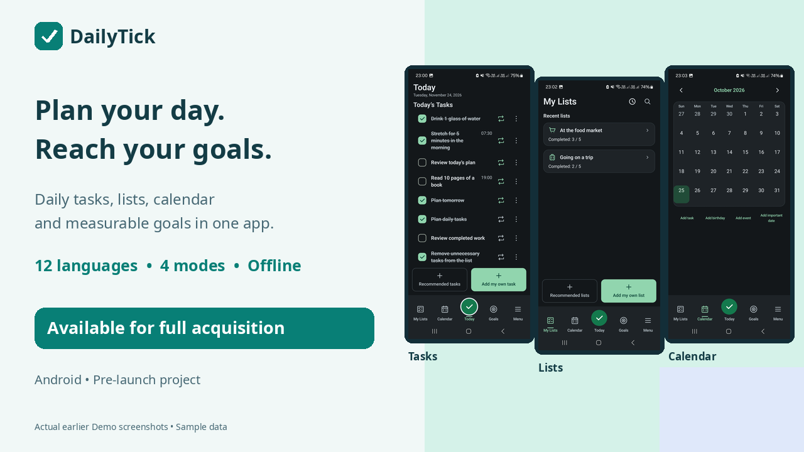
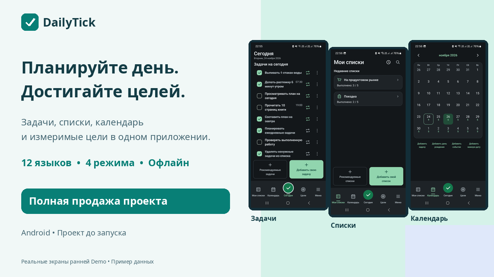
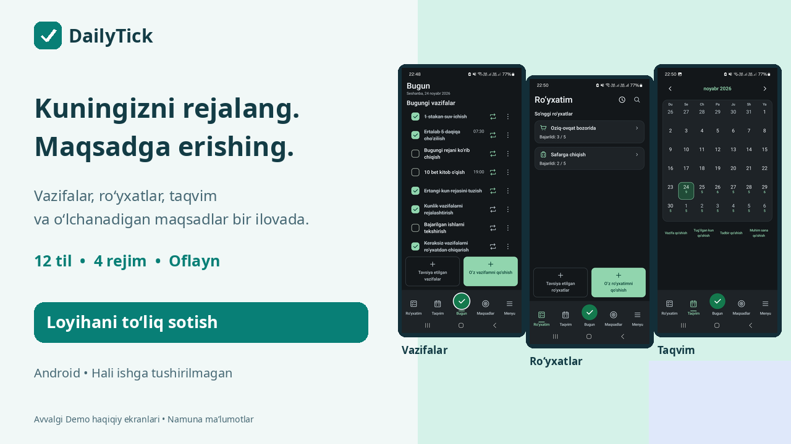

  

  

---
# ✅ DailyTick

### One App. Endless Possibilities.
### Одно приложение. Безграничные возможности.
### Bitta ilova. Cheksiz imkoniyatlar.

---

## 🇬🇧 English

### 🚀 Plan your day. Build habits. Achieve your goals.

DailyTick is an all-in-one Android productivity application designed to help people organize their daily lives, manage tasks, develop positive habits and achieve meaningful goals.

### ✨ Key Features

- ✅ Daily and recurring tasks
- 📋 Personal and recommended checklists
- 📅 Calendar and daily planning
- 🎯 Goals with 10 measurement units
- 📊 Progress tracking and statistics
- 🏆 Achievement milestones
- 🎓 Educational quizzes
- 🔔 Reminders and notifications
- 🌍 12 supported languages
- 🎨 4 appearance modes
- 📱 Offline functionality
- 💾 Local backup and restore
- 🔒 No mandatory account
- 🍃 No advertising in the current version

### 💎 Business Advantages

- Working Android application
- Kotlin and Jetpack Compose source code
- Multilingual product foundation
- No mandatory server infrastructure
- Potential for international expansion
- Marketing materials and user documentation

### 📈 Future Growth Opportunities

- Premium subscriptions
- Optional advertising
- Family and team plans
- AI-powered planning
- Optional cloud synchronization
- iOS and web expansion
- Education, finance and corporate solutions

These are proposed future development opportunities, not existing paid services.

### 🤝 Available for Full Acquisition

The entire project is offered for a one-time acquisition, including source code, transferable brand assets, documentation and marketing materials.

**Price: On request.**

---

## 🇷🇺 Русский

  

 
<h3>🚀 Планируйте день. Формируйте привычки. Достигайте целей.</h3>

DailyTick — универсальное Android-приложение для организации повседневной жизни, управления задачами, формирования полезных привычек и достижения личных целей.

### ✨ Основные возможности

- ✅ Ежедневные и повторяющиеся задачи
- 📋 Личные и рекомендуемые списки
- 📅 Календарь и планирование
- 🎯 Цели с 10 единицами измерения
- 📊 Статистика и отслеживание прогресса
- 🏆 Награды за достижения
- 🎓 Познавательные викторины
- 🔔 Напоминания и уведомления
- 🌍 Поддержка 12 языков
- 🎨 4 режима оформления
- 📱 Работа без интернета
- 💾 Локальное резервное копирование
- 🔒 Без обязательной регистрации
- 🍃 Без рекламы в текущей версии

### 💎 Преимущества для покупателя

- Рабочее Android-приложение
- Исходный код Kotlin и Jetpack Compose
- Многоязычная основа продукта
- Отсутствие обязательной серверной инфраструктуры
- Потенциал международного развития
- Маркетинговые материалы и документация

### 📈 Перспективы развития

- Премиум-подписки
- Опциональная реклама
- Семейные и командные тарифы
- Искусственный интеллект
- Облачная синхронизация
- Версии для iOS и Web
- Образовательные, финансовые и корпоративные решения

Перечисленные направления являются перспективами дальнейшего развития.

### 🤝 Полная продажа проекта

Проект предлагается к полной продаже с исходным кодом, передаваемыми активами бренда, документацией и маркетинговыми материалами.

**Цена: по запросу.**

---

## 🇺🇿 O‘zbekcha

  

 
<h3>🚀 Kuningizni rejalashtiring. Odatlaringizni shakllantiring. Maqsadlaringizga erishing.</h3>

DailyTick — kundalik hayotni tartibga solish, vazifalarni boshqarish, foydali odatlarni shakllantirish va shaxsiy maqsadlarga erishish uchun universal Android ilovasi.

### ✨ Asosiy imkoniyatlar

- ✅ Kundalik va takrorlanuvchi vazifalar
- 📋 Shaxsiy va tavsiya etilgan ro‘yxatlar
- 📅 Taqvim va rejalashtirish
- 🎯 10 o‘lchov birligidagi maqsadlar
- 📊 Statistika va natijalarni kuzatish
- 🏆 Yutuqlar uchun mukofotlar
- 🎓 Bilimni rivojlantiruvchi viktorinalar
- 🔔 Eslatmalar va bildirishnomalar
- 🌍 12 ta til
- 🎨 4 ta ko‘rinish rejimi
- 📱 Internetsiz ishlash
- 💾 Mahalliy zaxira nusxasi va tiklash
- 🔒 Majburiy ro‘yxatdan o‘tishsiz
- 🍃 Joriy versiyada reklamasiz

### 💎 Xaridor uchun afzalliklar

- Ishlaydigan Android ilovasi
- Kotlin va Jetpack Compose manba kodi
- Ko‘p tilli mahsulot asosi
- Majburiy server infratuzilmasining yo‘qligi
- Xalqaro bozorda rivojlanish salohiyati
- Marketing materiallari va hujjatlar

### 📈 Kelgusi rivojlanish imkoniyatlari

- Premium obunalar
- Ixtiyoriy reklama
- Oilaviy va jamoaviy tariflar
- Sun’iy intellekt
- Bulutli sinxronlash
- iOS va Web versiyalari
- Ta’lim, moliya va korporativ yechimlar

Mazkur yo‘nalishlar kelgusida amalga oshirilishi mumkin bo‘lgan rivojlanish konsepsiyalaridir.

### 🤝 Loyiha to‘liq sotuvga taklif etiladi

Ilova manba kodi, topshirilishi mumkin bo‘lgan brend aktivlari, hujjatlar va marketing materiallari bilan birgalikda to‘liq sotuvga taklif etiladi.

**Narxi: so‘rov asosida.**

---

## 📌 Product Status

- Functional Android application
- Device-tested demo
- Pre-launch / Pre-revenue
- Google Play publication is a future step

---

## 📩 Business & Acquisition Inquiries

📧 Email: [omonovtemurmalik@gmail.com](mailto:omonovtemurmalik@gmail.com)

✈️ Telegram: [@dailytickdemo](https://t.me/dailytickdemo)

**Full Acquisition • One-Time Payment • International Opportunity**

---

## 🔐 Intellectual Property

All rights reserved.

This repository is a product showcase only.
The application source code is not publicly distributed.
Transferable intellectual property rights are subject to a written acquisition agreement.

---

### DailyTick — Plan. Act. Achieve.
